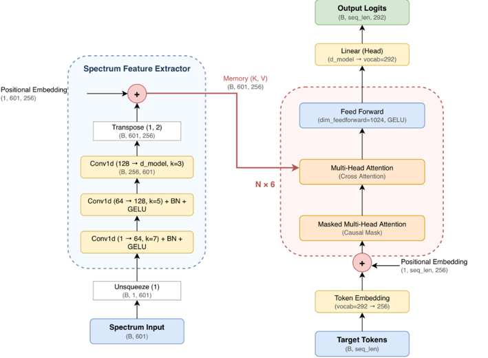

# Transformer用於多層薄膜反向設計

## Overview

本專題研究如何根據多層薄膜的光學穿透光譜，進行薄膜結構的**反向設計（Inverse Design）**。

目標是給定一組 target transmittance spectrum，找出重現該光譜的多層薄膜結構。整體方法結合了 **1D CNN-Encoder**與**Autoregressive Decoder**，並在預測後搭配 **Beam Search** 與 **L-BFGS-B** 做進一步篩選與最佳化。

本專題考慮兩種反向設計架構：

1. **固定 10 層結構**
   - 由 10 層交替排列的介電薄膜組成
   - 介電常數分別為 $\varepsilon = 3.9$ 與 $\varepsilon = 11.7$
   - 模型預測每一層的厚度

2. **可變 2–10 層結構**
   - 薄膜層數不固定
   - 起始材料可以是 $\varepsilon = 3.9$ 或 $\varepsilon = 11.7$
   - 材料種類以交替方式排列
   - 模型預測層數、材料序列與各層厚度

每一個薄膜結構對應的光學穿透響應，皆使用 **Transfer Matrix Method（TMM）** 計算。

---

## Method

### 1. 傳輸矩陣法（TMM）

本專題使用 **Transfer Matrix Method（TMM）** 計算多層薄膜的穿透光譜。對於正入射情況，可以將光在薄膜中的傳播過程分成兩部分：

- **傳輸（傳播）矩陣**：描述光在單一薄膜層中的相位累積
- **介面矩陣**：描述光在兩種材料交界面上的反射與穿透

#### (1) 傳輸矩陣

對第 $j$ 層薄膜，其傳輸矩陣可寫為

$$
P_j=
\begin{bmatrix}
e^{-i\delta_j} & 0 \\
0 & e^{i\delta_j}
\end{bmatrix},
$$

其中

$$
\delta_j=\frac{2\pi n_j d_j}{\lambda},
$$

$n_j$ 為第 $j$ 層的折射率，$d_j$ 為該層厚度，$\lambda$ 為入射光波長。

#### (2) 介面矩陣

材料 $i$ 與材料 $j$ 之間的介面矩陣為

$$
I_{ij}=\frac{1}{t_{ij}}
\begin{bmatrix}
1 & r_{ij} \\
r_{ij} & 1
\end{bmatrix},
$$

其中 Fresnel reflection / transmission coefficient 為

$$
r_{ij}=\frac{n_i-n_j}{n_i+n_j},
\qquad
t_{ij}=\frac{2n_i}{n_i+n_j}.
$$

#### (3) 總矩陣

因此，一個 $N$ 層薄膜結構的總矩陣可以表示為

$$
M = I_{01}P_1I_{12}P_2\cdots P_NI_{Ns}.
$$

由總矩陣即可進一步計算整體結構的反射與穿透光譜。本專題使用 TMM 進行：

- 資料集生成
- 神經網路預測結果驗證
- 最佳化過程中的光譜計算

#### 訓練資料生成

本專題的訓練資料皆先隨機產生薄膜結構，再利用 TMM 計算其對應的穿透光譜。每一層厚度皆限制在 **10–300 nm**，並以 **1 nm** 為間隔隨機取樣，因此訓練資料中的厚度皆為離散整數值。

- **固定 10 層資料集**：材料排列固定，僅隨機產生每一層的厚度。每層厚度皆由 10–300 nm 的整數值中隨機取樣。
- **可變 2–10 層資料集**：首先從 **2–10** 中隨機取一個整數決定薄膜層數，再從 $\varepsilon=3.9$ 與 $\varepsilon=11.7$ 中隨機選擇第一層材料。為了簡化模型的學習問題，後續材料強制交錯排列，因此不會出現連續兩層使用相同材料的情況；各層厚度由 10–300 nm，2nm為間隔的整數隨機取樣。層數不滿10層時，在結構的最後補上 $\varepsilon=11.7$ 且厚度 = 0nm的空層，以滿足所有結構都是用dim = 20的array表示。
- 每組結構皆利用 TMM 計算 **200–800 nm** 的穿透光譜，共 **601 個波長取樣點**。

模型訓練時，以穿透光譜作為輸入，對應的薄膜結構序列作為 target，使模型學習由光譜反推出薄膜結構。

---

### 2. CNN-Transformer 網路架構

本專題使用 **1D CNN Encoder + Autoregressive Transformer Decoder**，將輸入的目標穿透光譜轉換成對應的薄膜結構 token sequence。



- **1D CNN Encoder**：從輸入的穿透光譜中提取特徵
- **Transformer Decoder**：根據 encoder 輸出的光譜特徵，以 autoregressive 的方式逐步預測下一個 token
- **Design Tokens**：用於表示薄膜結構中的材料與厚度資訊

訓練時使用 **Teacher Forcing**；推論時則使用 **Beam Search** 產生多組候選結構。

#### Tokenization

本專題針對兩種反向設計問題，分別使用不同的 token 表示方式。

**固定 10 層結構**

厚度範圍為 **10–300 nm**，並以 **1 nm** 為間隔離散化，因此共有 291 種可能的厚度。每一個厚度對應一個獨立 token，再加上 decoder 所需的起始 token，因此固定 10 層模型的 **vocabulary size = 292**。模型不直接回歸連續厚度，而是逐層預測對應的 thickness token。

**可變 2–10 層結構**

可變層數模型除了厚度之外，還需要表示結構的起始材料。由於材料被限制為交錯排列，因此只要知道第一層材料以及各層厚度，就可以還原完整的材料序列。

由於每筆資料的層數可能不同，為了能以相同長度組成 batch，較短的結構會在有效資料之後以 **0 進行 padding**，補到固定的最大序列長度。例如一個只有 4 層的結構，在記錄完起始材料與 4 層厚度後，其餘位置皆補 0。訓練時這些 padding 位置不代表實際薄膜層，而只是用來統一序列長度。

完成模型預測後，再將 token sequence 還原成實際的材料與厚度，並利用 TMM 計算其穿透光譜。

---

### 3. Beam Search

**Beam Search** 不只保留每一步機率最高的單一結果，而是同時保留數個較好的候選序列，以降低早期預測錯誤對最終結果的影響。

本專題在推論時採用 Beam Search，找出**最好的幾個候選薄膜結構**，再利用 TMM 計算各候選結構所對應的穿透光譜，最後選擇與 target spectrum 誤差最小的結構。

---

### 4. L-BFGS-B

**L-BFGS-B** 是一種使用**一階數值微分**的最佳化演算法，並且可以設定變數的上下界，擁有非常強的局部收斂性，是目前對於局部收斂相當泛用的選擇。本專題將神經網路預測出的薄膜厚度作為初始值，再利用 L-BFGS-B 進一步微調厚度。

其 target function 為穿透光譜的 **Mean Absolute Error（MAE）**：

$$
\mathrm{MAE}
=
\frac{1}{N_{\lambda}}
\sum_{k=1}^{N_{\lambda}}
\left|
T_{\mathrm{pred}}(\lambda_k)
-
T_{\mathrm{target}}(\lambda_k)
\right|
$$

---

### 5. 粒子群最佳化（PSO）

**Particle Swarm Optimization（PSO）** 是一種群體式最佳化方法，可以視為模擬一群粒子在搜尋空間中隨機移動。每個粒子代表一組可能的薄膜厚度配置，並在搜尋過程中逐步往較好的解移動。

本專題使用 PSO 作為傳統最佳化方法的比較基準，透過反覆進行 TMM 計算來搜尋較佳的薄膜結構。

---

### 6. 整體反向設計流程

```text
目標穿透光譜
      ↓
1D CNN Encoder
      ↓
光譜特徵序列
      ↓
Autoregressive Transformer Decoder
      ↓
Beam Search
      ↓
候選薄膜結構
      ↓
TMM 評估
      ↓
最佳離散結構
      ↓
L-BFGS-B
      ↓
連續厚度微調
```

PSO 則另外作為最佳化基準方法進行比較。

---

## 專案結構

- `simulation.py` — TMM 模擬程式
- `generate_fixed_dataset.py` — 固定 10 層資料集生成
- `generate_variable_dataset.py` — 可變 2–10 層資料集生成
- `train_fixed.ipynb` — 固定層數模型訓練
- `train_variable.ipynb` — 可變層數模型訓練
- `test_fixed.ipynb` — 固定層數模型測試
- `test_variable.ipynb` — 可變層數模型測試

---

## 使用方式

### 1. 生成資料集

執行對應的資料集生成程式。

### 2. 訓練模型

在訓練 notebook 中設定資料集路徑：

```python
DATA_DIR = "path/to/dataset"
```

### 3. 測試模型

在測試程式或 notebook 中設定訓練完成的模型路徑：

```python
MODEL_PATH = "path/to/model.pth"
```